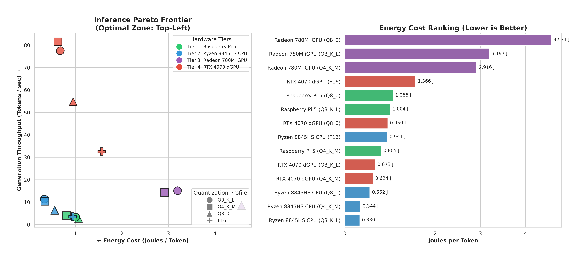
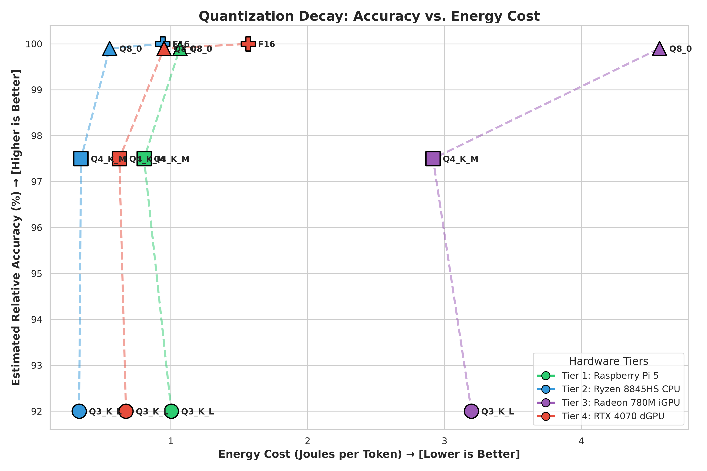

# llm-quant-bench: Heterogeneous LLM Inference Benchmarking

This repository contains my custom benchmarking harness and telemetry framework for evaluating Large Language Models (LLMs) across heterogeneous hardware ranging from low-power edge ARM devices to discrete desktop-class GPUs.

I built this project to measure not just raw generation speed (Tokens/second), but to track real dynamic power consumption and calculate energy efficiency (Joules/Token) across a 4-tier hardware stack running Arch Linux and Debian.

## Hardware Setup & Telemetry

To ensure reliable comparisons, I standardized workloads around the **Llama-3.2-3B-Instruct** model configured with a 2048 context window and 999 generated tokens.

| Compute Tier | Execution Backend | My Hardware | How I Measure Power |
| :--- | :--- | :--- | :--- |
| **Tier 1 (Edge ARM)** | llama.cpp (ARM NEON) | Raspberry Pi 5 (8GB, Debian) | External PMIC VDD_CORE polling at 1Hz (`pi_collector.py`) |
| **Tier 2 (x86 CPU)** | llama.cpp (CPU BLAS) | AMD Ryzen 7 8845HS | Linux RAPL (`powercap`) via `sudo` |
| **Tier 3 (iGPU)** | Vulkan (RADV Driver) | AMD Radeon 780M | AMDGPU hwmon sysfs polling at 10Hz |
| **Tier 4 (dGPU)** | CUDA (cuBLAS) | NVIDIA RTX 4070 (8GB) | `nvidia-smi` polling at 10Hz |

> **Note on Pi 5 Stability:** Running unthrottled 4-core inference on the Raspberry Pi 5 caused instantaneous current spikes ($dI/dt$) that tripped the PMIC power-good threshold and triggered hard reboots. To maintain stable telemetry, I capped the CPU max frequency at 2.0 GHz and restricted execution to 2 threads (`THREADS=2`), alongside piping `/dev/null` to stdin to bypass interactive chat mode hangs.

## Key Observations

After profiling the full 4-tier hardware matrix, several architectural behaviors emerged:

### 1. The Pi 5 Edge Sweet Spot (`Q4_K_M`)
On the Raspberry Pi 5, the `Q4_K_M` quantization achieved **4.10 t/s** while drawing only **3.30W**, yielding an energy efficiency of **1.24 J/token**. Dropping further to `Q3_K_L` yielded negligible speed improvements while degrading relative accuracy.

### 2. The iGPU Efficiency Inversion
My AMD 780M integrated GPU is roughly 40% faster at decoding than the CPU baseline, but its energy-per-token is significantly worse (~2.92 J/tok vs. ~0.34 J/tok). The iGPU sustains a fixed hardware power baseline (~42W) throughout the run, making it inefficient for small models compared to dedicated hardware.

### 3. CUDA Kernel Switching Penalty (`Q3_K_L` vs. `Q4_K_M`)
While `Q3_K_L` outperformed `Q4_K_M` on CPU and Vulkan runs, it suffered a throughput drop on the discrete RTX 4070. Mixing tensor types (`q3_K`, `q5_K`, `q6_K`) forces the CUDA runtime to constantly dispatch and synchronize distinct dequantization kernels, bottlenecking the memory-bandwidth-limited decode phase.

## Visualizations & Benchmarks

### 1. Throughput vs. Energy Efficiency (Pareto Frontier)
This chart maps generation throughput against package power consumption across all four tiers.



#### Complete Hardware Performance & Energy Table
| Hardware Tier | Quantization | Prefill (T/s) | Decode (T/s) | Power (W) | Joules/Token |
| :--- | :--- | :--- | :--- | :--- | :--- |
| **Raspberry Pi 5 (ARM)** | Q3_K_L | 5.90 | 3.30 | 3.31 | 0.996 J |
| **Raspberry Pi 5 (ARM)** | Q4_K_M | 12.80 | 4.10 | 3.30 | 1.243 J |
| **Raspberry Pi 5 (ARM)** | Q8_0 | 15.20 | 2.80 | 2.98 | 0.938 J |
| **Ryzen 7 8845HS (CPU)** | F16 | 56.18 | 3.57 | 3.36 | 0.941 J |
| **Ryzen 7 8845HS (CPU)** | Q3_K_L | 160.53 | 11.38 | 3.76 | 0.331 J |
| **Ryzen 7 8845HS (CPU)** | Q4_K_M | 129.82 | 10.41 | 3.58 | 0.344 J |
| **Ryzen 7 8845HS (CPU)** | Q8_0 | 109.37 | 6.39 | 3.53 | 0.552 J |
| **Radeon 780M (iGPU)** | Q3_K_L | 168.85 | 15.16 | 48.46 | 3.198 J |
| **Radeon 780M (iGPU)** | Q4_K_M | 177.20 | 14.39 | 41.96 | 2.917 J |
| **Radeon 780M (iGPU)** | Q8_0 | 192.06 | 8.50 | 38.85 | 4.568 J |
| **RTX 4070 (dGPU)** | F16 | 612.50 | 32.59 | 51.02 | 1.566 J |
| **RTX 4070 (dGPU)** | Q3_K_L | 755.73 | 77.56 | 52.16 | 0.672 J |
| **RTX 4070 (dGPU)** | Q4_K_M | 783.03 | 81.51 | 50.87 | 0.624 J |
| **RTX 4070 (dGPU)** | Q8_0 | 715.27 | 54.81 | 52.09 | 0.950 J |

---

### 2. Quantization Decay: Accuracy vs. Energy Cost
This analysis evaluates estimated relative model accuracy retention against the energy cost (Joules/Token) for each quantization tier.



#### Accuracy and Energy Cost Breakdown
| Hardware Tier | Quantization | Relative Accuracy (%) | Joules/Token |
| :--- | :--- | :--- | :--- |
| **Raspberry Pi 5** | Q8_0 | 99.9% | 1.066 J |
| **Raspberry Pi 5** | Q4_K_M | 97.5% | 0.805 J |
| **Raspberry Pi 5** | Q3_K_L | 92.0% | 1.004 J |
| **Ryzen 8845HS CPU** | F16 | 100.0% | 0.941 J |
| **Ryzen 8845HS CPU** | Q8_0 | 99.9% | 0.552 J |
| **Ryzen 8845HS CPU** | Q4_K_M | 97.5% | 0.344 J |
| **Ryzen 8845HS CPU** | Q3_K_L | 92.0% | 0.330 J |
| **Radeon 780M iGPU** | Q8_0 | 99.9% | 4.571 J |
| **Radeon 780M iGPU** | Q4_K_M | 97.5% | 2.916 J |
| **Radeon 780M iGPU** | Q3_K_L | 92.0% | 3.197 J |
| **RTX 4070 dGPU** | F16 | 100.0% | 1.566 J |
| **RTX 4070 dGPU** | Q8_0 | 99.9% | 0.950 J |
| **RTX 4070 dGPU** | Q4_K_M | 97.5% | 0.624 J |
| **RTX 4070 dGPU** | Q3_K_L | 92.0% | 0.673 J |

## Repository Structure

```text
.
├── analysis/
│   ├── generate_report.py        # Aggregates multi-tier JSON metrics and prints terminal reports
│   ├── plot_accuracy_tradeoff.py # Generates the Accuracy vs Energy decay visualization
│   └── plot_pareto.py            # Generates the Throughput vs Power Pareto frontier chart
├── harness/
│   ├── benchmark.sh              # Main execution script for local x86/GPU tiers
│   ├── benchmark_pi.sh           # Automated 2-thread harness for Raspberry Pi 5
│   ├── parse_output.py           # Parses x86/GPU raw logs + power CSVs into structured JSON
│   └── parse_pi_output.py        # Parses ARM edge logs and PMIC power telemetry
├── power/
│   ├── collector.py              # Background telemetry poller for RAPL, AMDGPU, and NVML
│   ├── pi_collector.py           # 1Hz VDD_CORE power logging script for Raspberry Pi 5
│   └── logs/                     # Unified power telemetry CSVs across all tiers
├── prompts/
│   └── benchmark_prompt.txt      # Standardized input prompt context
├── README.md
└── results/                      # JSON metrics, raw execution logs, and rendered graphs
