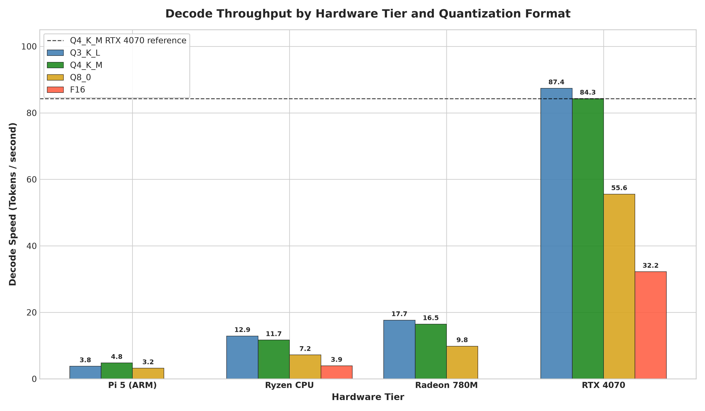
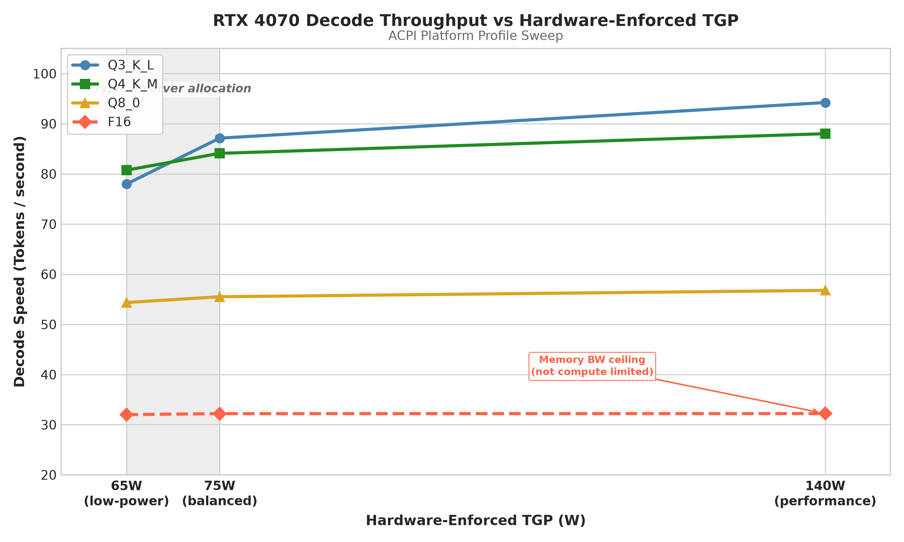
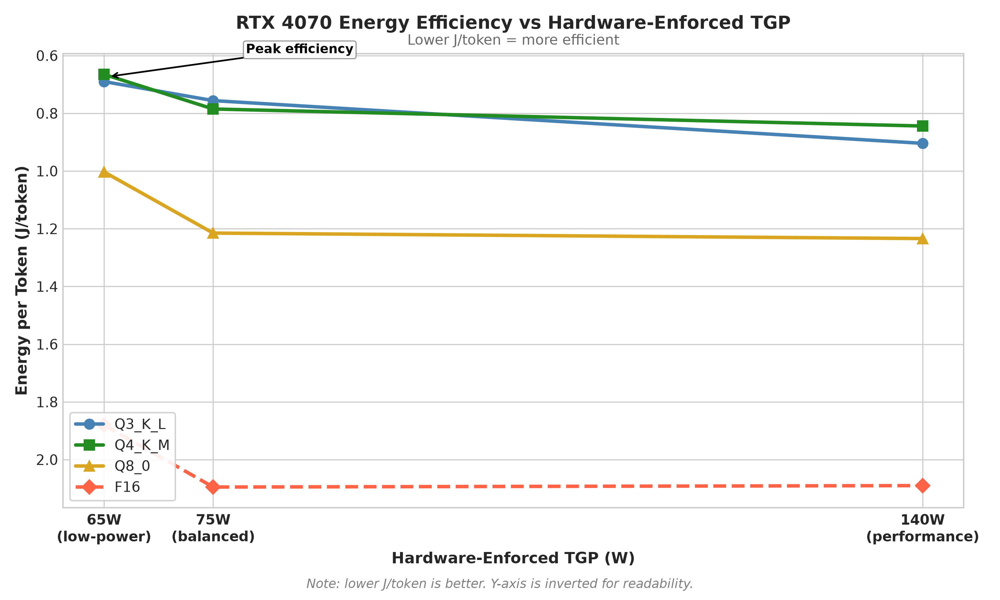

# llm-quant-bench

A reproducible benchmarking harness for measuring LLM inference throughput,
power consumption, and energy efficiency across heterogeneous hardware. I
built this to go beyond raw Tokens/second and produce empirical Joules/Token
data across a full hardware stack, from a Raspberry Pi 5 to a discrete GPU.

This project spans two studies. Study 1 maps the Pareto frontier of decode
throughput against energy cost across four hardware tiers and four quantization
formats. Study 2 extends the discrete GPU analysis into power-constrained
environments using hardware-enforced ACPI platform profiles to simulate
node-level power budgets.

The documentation for this project lives in the [docs/](docs/) directory.
I recommend reading it in order if you want to understand every design
decision and finding.

---

## Hardware and Telemetry

I ran all benchmarks using [Llama-3.2-3B-Instruct](https://huggingface.co/meta-llama/Llama-3.2-3B-Instruct)
with a standardized 2048-token context window and 999 generated tokens per run.
For the reasoning behind this model choice and why I selected these specific
quantization formats, see [docs/03-model-and-quantization.md](docs/03-model-and-quantization.md).

| Compute Tier | Backend | Hardware | Power Measurement |
| :--- | :--- | :--- | :--- |
| Tier 1 (Edge ARM) | llama.cpp ARM NEON | Raspberry Pi 5, 8GB, Debian | PMIC VDD_CORE polling at 1Hz |
| Tier 2 (x86 CPU) | llama.cpp CPU BLAS | AMD Ryzen 7 8845HS | Linux RAPL powercap via sudo |
| Tier 3 (iGPU) | Vulkan, RADV driver | AMD Radeon 780M | AMDGPU hwmon sysfs at 10Hz |
| Tier 4 (dGPU) | CUDA, cuBLAS | NVIDIA RTX 4070 8GB | nvidia-smi at 10Hz |

For detailed telemetry design decisions, see
[docs/02-hardware-and-telemetry.md](docs/02-hardware-and-telemetry.md).

> **Pi 5 stability:** Unthrottled 4-core inference caused current spikes that
> tripped the PMIC power-good threshold and caused hard reboots. I capped the
> CPU at 2.0 GHz and limited execution to 2 threads, and piped /dev/null to
> stdin to prevent interactive mode hangs. See
> [docs/02-hardware-and-telemetry.md](docs/02-hardware-and-telemetry.md)
> for the full explanation.

> **CPU RAPL scope:** The Ryzen 8845HS readings capture CPU die package power
> only. DRAM, SoC uncore, and peripheral power are excluded. Add approximately
> 3 to 5W for node-level comparisons.

> **Optimus laptop isolation:** To benchmark the AMD 780M independently, I
> forced the Vulkan ICD to the RADV driver using VK_ICD_FILENAMES. Without
> this, NVIDIA's Optimus drivers silently route all Vulkan workloads to the
> discrete GPU.

> **F16 exclusions:** F16 inference was excluded from Tier 1 (Pi 5) due to
> insufficient RAM headroom, and from Tier 3 (AMD 780M) because the RADV
> Vulkan driver cannot satisfy a single contiguous 6 GiB device memory
> allocation under Linux. The full technical explanation is in
> [docs/03-model-and-quantization.md](docs/03-model-and-quantization.md).

---

## Study 1: Heterogeneous Hardware Benchmarking

### Key Findings

**Finding 1: The Pi 5 throughput-efficiency split.**
On the Raspberry Pi 5, Q4_K_M delivers the highest decode throughput at
4.80 T/s. However Q8_0 is the most energy-efficient format at 1.257 J/token
despite being slower. The Pi's ARM NEON dequantizes Q8 weights more
efficiently than Q4_K_M under the 2-thread ceiling, and Q8_0 also draws
slightly less power. The optimal format on edge hardware depends entirely on
whether the constraint is latency or battery life. See
[docs/04-study1-methodology-and-findings.md](docs/04-study1-methodology-and-findings.md).

**Finding 2: The iGPU efficiency inversion.**
The AMD 780M is roughly 40% faster than the CPU baseline but costs 6x more
energy per token at Q4_K_M (1.88 J/tok vs 0.31 J/tok). To run any GPU
workload, the iGPU must hold its full clock domain at operating voltage for
the entire inference window. For a 3B parameter model, the fixed overhead
makes the iGPU an efficiency dead zone. Full analysis in
[docs/04-study1-methodology-and-findings.md](docs/04-study1-methodology-and-findings.md).

**Finding 3: The CUDA kernel switching penalty.**
Q3_K_L outperforms Q4_K_M on both CPU and Vulkan tiers. On the RTX 4070,
Q3_K_L is slower. The Q3_K_L format uses three distinct tensor types (q3_K,
q5_K, q6_K), confirmed in the llama.cpp loader output. Each layer boundary
during decode triggers a different CUDA dequantization kernel with its own
grid configuration. This dispatch overhead is negligible on CPU BLAS and
UMA Vulkan but measurable on CUDA's discrete command queue. Full explanation
in [docs/04-study1-methodology-and-findings.md](docs/04-study1-methodology-and-findings.md).

---

### Graph 1: Pareto Frontier


Each point is a hardware-quantization combination. Points toward the top-left
represent the optimal zone: higher throughput at lower energy cost. The RTX
4070 with Q3_K_L or Q4_K_M represents the best performance per watt among
GPU tiers. The Ryzen CPU with Q3_K_L holds the global energy efficiency record
across the entire study at 0.29 J/token.

---

### Graph 2: Decode Throughput Across All Tiers



The discrete GPU achieves roughly 7x the throughput of the CPU and 5x the
throughput of the iGPU at the same quantization level. The Pi 5 throughput
is limited by the 2-thread cap imposed for stability.

---

### Graph 3: Accuracy Retention vs Energy Cost


Accuracy retention values are literature-sourced estimates from llama.cpp
quantization benchmarks, not independently measured. They are shown to
contextualise the efficiency figures. Q4_K_M retains approximately 99.2% of
F16 accuracy while delivering the best energy efficiency on the CPU and
competitive efficiency on the GPU. See
[docs/03-model-and-quantization.md](docs/03-model-and-quantization.md) and
[1] for the source of these estimates.

---

### Table 1: Study 1 - Complete Performance and Power Matrix

| Hardware Tier | Quantization | Prefill (T/s) | Decode (T/s) | Power (W) | J/token |
| :--- | :--- | :--- | :--- | :--- | :--- |
| Raspberry Pi 5 (ARM) | Q3_K_L | 7.00 | 3.80 | 4.54 | 1.195 |
| Raspberry Pi 5 (ARM) | Q4_K_M | 15.10 | 4.80 | 4.46 | **0.929** |
| Raspberry Pi 5 (ARM) | Q8_0 | 17.40 | 3.20 | 4.02 | 1.257 |
| Ryzen 7 8845HS (CPU) | F16 | 80.57 | 3.93 | 3.15 | 0.800 |
| Ryzen 7 8845HS (CPU) | Q3_K_L | 207.22 | 12.90 | 3.78 | **0.293** |
| Ryzen 7 8845HS (CPU) | Q4_K_M | 195.86 | 11.67 | 3.57 | 0.306 |
| Ryzen 7 8845HS (CPU) | Q8_0 | 120.78 | 7.20 | 3.39 | 0.471 |
| Radeon 780M (iGPU) | Q3_K_L | 176.86 | 17.67 | 37.51 | 2.123 |
| Radeon 780M (iGPU) | Q4_K_M | 185.04 | 16.47 | 31.01 | 1.882 |
| Radeon 780M (iGPU) | Q8_0 | 199.14 | 9.84 | 30.12 | 3.061 |
| RTX 4070 (dGPU) | F16 | 688.72 | 32.22 | 70.02 | 2.173 |
| RTX 4070 (dGPU) | Q3_K_L | 897.06 | 87.39 | 70.06 | 0.802 |
| RTX 4070 (dGPU) | Q4_K_M | 869.42 | **84.29** | 69.80 | 0.828 |
| RTX 4070 (dGPU) | Q8_0 | 757.17 | 55.56 | 70.34 | 1.266 |

*Bold values indicate peak performance or best efficiency within each hardware
tier. RTX 4070 power variance across quantizations is under 0.9%, confirming
the GPU was operating at its firmware TDP ceiling throughout.*

---

### Table 2: Study 1 - Estimated Accuracy Retention vs Energy Cost

Accuracy retention figures are community-sourced estimates from llama.cpp
perplexity benchmarks [1], not independently measured in this project.

| Hardware Tier | Quantization | Est. Accuracy Retention | J/token |
| :--- | :--- | :--- | :--- |
| Raspberry Pi 5 | Q8_0 | ~99.9% | 1.257 |
| Raspberry Pi 5 | Q4_K_M | ~99.2% | 0.929 |
| Raspberry Pi 5 | Q3_K_L | ~96.5% | 1.195 |
| Ryzen 8845HS (CPU) | F16 | 100% (baseline) | 0.800 |
| Ryzen 8845HS (CPU) | Q8_0 | ~99.9% | 0.471 |
| Ryzen 8845HS (CPU) | Q4_K_M | ~99.2% | 0.306 |
| Ryzen 8845HS (CPU) | Q3_K_L | ~96.5% | 0.293 |
| Radeon 780M (iGPU) | Q8_0 | ~99.9% | 3.061 |
| Radeon 780M (iGPU) | Q4_K_M | ~99.2% | 1.882 |
| Radeon 780M (iGPU) | Q3_K_L | ~96.5% | 2.123 |
| RTX 4070 (dGPU) | F16 | 100% (baseline) | 2.173 |
| RTX 4070 (dGPU) | Q8_0 | ~99.9% | 1.266 |
| RTX 4070 (dGPU) | Q4_K_M | ~99.2% | 0.828 |
| RTX 4070 (dGPU) | Q3_K_L | ~96.5% | 0.802 |

---

## Study 2: Power-Constrained Inference on the RTX 4070

I extended the GPU analysis by sweeping three hardware-enforced ACPI platform
profiles on the Lenovo Legion. Unlike software power caps, these profiles are
enforced by the laptop's Embedded Controller and cannot be overridden by the
workload. This simulates the kind of node-level power budget constraints found
in modern data centres.

For the full methodology, including why I chose this approach over
nvidia-smi -pl and how nvidia-powerd was configured, see
[docs/05-study2-power-sweep.md](docs/05-study2-power-sweep.md).

### Graph 4: TGP Sweep - Decode Throughput vs Power Budget



Q3_K_L benefits most from the expanded TGP in performance mode, climbing
from 78.0 T/s at 65W to 94.2 T/s at 140W. F16 throughput is almost
completely insensitive to the power budget across all three profiles,
confirming that F16 decode is bound by a different bottleneck than the
quantized formats.

---

### Graph 5: TGP Sweep - Energy Efficiency vs Power Budget



The low-power profile at 65W TGP produces the best energy efficiency for
Q3_K_L and Q4_K_M. More power does not linearly translate to more
efficiency for these formats. Q8_0 efficiency improves modestly with
increased TGP, while F16 remains the worst performer at all power levels.

---

### Table 3: Study 2 - Power Profile Sweep Results

| ACPI Profile | TGP (W) | Quantization | Decode (T/s) | Power (W) | J/token |
| :--- | :--- | :--- | :--- | :--- | :--- |
| low-power | 65.0 | F16 | 32.01 | 60.18 | 1.880 |
| low-power | 65.0 | Q3_K_L | 77.98 | 53.82 | **0.690** |
| low-power | 65.0 | Q4_K_M | 80.75 | 53.71 | **0.665** |
| low-power | 65.0 | Q8_0 | 54.36 | 54.51 | 1.003 |
| balanced | 75.0 | F16 | 32.21 | 67.48 | 2.095 |
| balanced | 75.0 | Q3_K_L | 87.13 | 65.87 | 0.756 |
| balanced | 75.0 | Q4_K_M | 84.10 | 65.99 | 0.785 |
| balanced | 75.0 | Q8_0 | 55.51 | 67.42 | 1.215 |
| performance | 140.0 | F16 | 32.22 | 67.33 | 2.090 |
| performance | 140.0 | Q3_K_L | **94.23** | 85.13 | 0.904 |
| performance | 140.0 | Q4_K_M | 88.02 | 74.25 | 0.844 |
| performance | 140.0 | Q8_0 | 56.78 | 70.07 | 1.234 |

*Bold values indicate peak decode speed or best energy efficiency per
quantization format across profiles. F16 decode throughput does not
improve with increased TGP because it is memory-bandwidth limited by the
weight transfer rate, not compute throughput.*

---

## How to Run This

**1. x86 and GPU tiers:**

```bash
./harness/benchmark.sh "tier4" "rtx4070" "q4km" \
  "models/Llama-3.2-3B-Instruct-Q4_K_M.gguf"
```

> The CPU tier requires sudo for RAPL sensor access.

**2. Raspberry Pi 5:**

```bash
./harness/benchmark_pi.sh "tier1" "pi5" "q4km" \
  "models/Llama-3.2-3B-Instruct-Q4_K_M.gguf"
```

**3. Power profile sweep (Study 2):**

```bash
sudo ./power_cap_sweep/run_sweep.sh
```

> Requires nvidia-powerd running:
> `sudo systemctl enable --now nvidia-powerd.service`

**4. Generate analysis charts:**

```bash
python3 analysis/plot_pareto.py
python3 analysis/plot_accuracy_tradeoff.py
python3 analysis/plot_power_sweep.py
```

---

## Repository Structure

```text
.
├── analysis/
│   ├── generate_report.py
│   ├── plot_accuracy_tradeoff.py
│   ├── plot_pareto.py
│   └── plot_power_sweep.py
├── docs/
│   ├── 01-motivation-and-background.md
│   ├── 02-hardware-and-telemetry.md
│   ├── 03-model-and-quantization.md
│   ├── 04-study1-methodology-and-findings.md
│   ├── 05-study2-power-sweep.md
│   └── 06-limitations-and-future-work.md
├── harness/
│   ├── benchmark.sh
│   ├── parse_output.py
│   └── parse_pi_output.py
├── power/
│   ├── collector.py
│   ├── pi_collector.py
│   └── logs/
├── power_cap_sweep/
│   ├── run_sweep.sh
│   ├── set_power_cap.py
│   └── results/
├── prompts/
│   └── benchmark_prompt.txt
├── README.md
└── results/
    ├── cpu_baseline/
    ├── tier1_arm/
    ├── tier3_vulkan/
    └── tier4_cuda/
```

---

## References

[1] Gerganov, G. et al. (2023). llama.cpp: Quantization types and k-quants.
GitHub. https://github.com/ggerganov/llama.cpp

[2] Meta AI. (2024). Llama 3.2 Model Card.
https://huggingface.co/meta-llama/Llama-3.2-3B-Instruct

[3] Frantar, E., Ashkboos, S., Hoefler, T., & Alistarh, D. (2023).
GPTQ: Accurate Post-Training Quantization for Generative Pre-trained
Transformers. ICLR 2023. https://arxiv.org/abs/2210.17323

[4] Lin, J., Tang, J., Tang, H., Yang, S., Dang, X., & Han, S. (2024).
AWQ: Activation-aware Weight Quantization for On-Device LLM Compression
and Acceleration. MLSys 2024. https://arxiv.org/abs/2306.00978

[5] Williams, S., Waterman, A., & Patterson, D. (2009). Roofline: An
Insightful Visual Performance Model for Multicore Architectures.
Communications of the ACM, 52(4), 65-76.
https://doi.org/10.1145/1498765.1498785

[6] Nagel, M., Fournarakis, M., Amjad, R. A., Bondarenko, Y., van Baalen,
M., & Blankevoort, T. (2021). A White Paper on Neural Network Quantization.
Qualcomm AI Research. https://arxiv.org/abs/2106.08295

[7] NVIDIA. (2024). NVML API Reference Guide.
https://docs.nvidia.com/deploy/nvml-api/

[8] Intel. (2023). Running Average Power Limit (RAPL) Energy Reporting.
https://www.kernel.org/doc/html/latest/power/powercap/powercap.html

[9] Larabel, M. (2021). Linux 5.12 ACPI Platform Profile Support.
Phoronix. https://www.phoronix.com/news/Linux-ACPI-Platform-Profile

[10] Karlin, I. (2026). Beyond Moore's Lab: Power and Energy Efficiency
on Modern GPUs. Department of Electrical and Computer Engineering,
Queen's University.
https://smithengineering.queensu.ca/research-grad-studies/grad-postdoc-positions.html

[11] ARM. (2023). ARM NEON Programmer's Guide.
https://developer.arm.com/documentation/den0018/latest

[12] Dettmers, T., Lewis, M., Shleifer, S., & Zettlemoyer, L. (2022).
LLM.int8(): 8-bit Matrix Multiplication for Transformers at Scale.
NeurIPS 2022. https://arxiv.org/abs/2208.07339

[13] Kwon, W., Li, Z., Zhuang, S., Sheng, Y., Zheng, L., Yu, C. H.,
Gonzalez, J., Zhang, H., & Stoica, I. (2023). Efficient Memory Management
for Large Language Model Serving with PagedAttention. SOSP 2023.
https://arxiv.org/abs/2309.06180
